# NeoCore Computer Lab

**Relatório técnico — simulador didático da arquitetura interna de um computador**

Disciplina: Computer Architecture and Organization — UniFECAF

Autor: ⟨preencher: nome do autor⟩

Data: novembro de 2026

Aplicação: ⟨preencher na Fase 8: link da Vercel⟩ · Vídeo pitch: ⟨preencher: link do YouTube⟩

## Sumário

1. Contextualização
2. Arquitetura escolhida
3. Diagrama geral
4. CPU: Unidade de Controle, ULA e registradores
5. Hierarquia de memória e o papel da cache
6. Barramentos de dados, endereços e controle (6.1 E/S mapeada em memória)
7. Fluxo de dados entre os componentes
8. Ciclo de busca, decodificação e execução (8.1 Execução passo a passo de `ADD R0, R1`)
9. Conclusão e trabalhos futuros
- Referências
- Apêndice A — Arquivos da simulação
- Apêndice B — Vídeo pitch

## 1. Contextualização

A **NeoCore Tech** é uma empresa de tecnologia educacional que atende escolas técnicas, universidades e centros de formação. Nos cursos que ela apoia, os estudantes aprendem registradores, Unidade Lógica e Aritmética (ULA), Unidade de Controle (UC), cache, memória principal e barramentos em capítulos separados. O resultado é um conhecimento fragmentado: o aluno sabe definir cada peça, mas não consegue explicar como elas trabalham juntas para executar um programa.

Este trabalho entrega, como prova de conceito, o **NeoCore Computer Lab**: um simulador web que executa programas reais em uma CPU didática, a **NeoCore-8**, e torna visível cada passo da execução. O simulador responde à pergunta central do projeto:

> Como os diferentes componentes de um computador trabalham de forma coordenada para buscar, interpretar e executar uma instrução?

A resposta é dada **microetapa a microetapa**. A cada passo, o simulador mostra qual componente age, qual barramento é usado, qual sinal de controle é emitido e qual valor muda, acompanhado de uma explicação em português gerada pelo próprio motor da simulação. O estudante pode avançar, voltar, executar continuamente, mudar a entrada do teclado e escrever os próprios programas em assembly.

## 2. Arquitetura escolhida

A NeoCore-8 é uma máquina **Von Neumann com traços RISC**, de palavra de 16 bits, sem pipeline e com E/S mapeada em memória.

**Von Neumann.** Uma única memória guarda instruções e dados, e um único conjunto de barramentos liga a CPU à memória e à E/S. É a arquitetura de referência no ensino (Tanenbaum; Stallings) e torna visível o **gargalo de Von Neumann**: a busca de instruções e o acesso a dados disputam o mesmo caminho. No simulador, isso aparece na contagem de ciclos. No exemplo 1, as 6 leituras da RAM (5 delas buscas de instrução) custam 24 ciclos de espera, ou 37% dos 65 ciclos da execução.

A Figura 1 mostra o boot: o *loader* copia o programa do disco para a RAM, e as instruções (a partir de `0x00`) e o dado (`7`, em `0x20`) ficam na mesma memória.

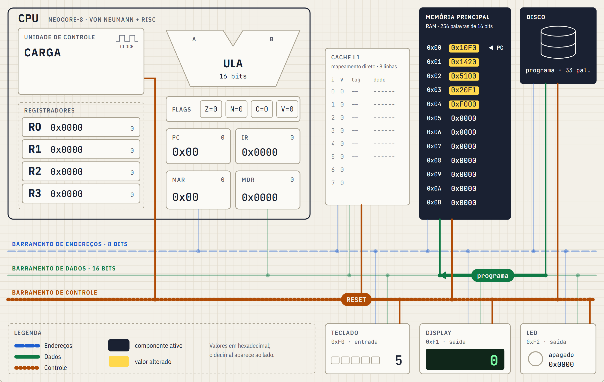

**Traços RISC incorporados.**

- **Load/store:** só `LOAD` e `STORE` acessam a memória; a ULA opera apenas sobre registradores. Isso separa com clareza as instruções que usam os barramentos das que ficam dentro da CPU.
- **Formato fixo de 16 bits:** toda instrução tem os mesmos quatro campos, decodificados da mesma forma (seção 8).
- **Conjunto pequeno de 14 instruções:** cada uma tem uma sequência curta e distinta de microetapas, o que reduz a carga cognitiva do aluno.

**Sem pipeline.** Uma instrução termina antes de a próxima começar. Assim, cada fase do ciclo pode ser observada isoladamente; o pipeline é apresentado como evolução natural (seção 9).

**E/S mapeada em memória.** Teclado (`0xF0`), display (`0xF1`) e LED (`0xF2`) ocupam endereços fixos e são acessados com `LOAD` e `STORE` comuns, coerente com a filosofia load/store.

**Alternativas consideradas.** Uma arquitetura **Harvard** (memórias separadas para instruções e dados) eliminaria o gargalo que se quer justamente mostrar. Uma ISA **CISC**, com modos de endereçamento complexos e instruções de tamanho variável, multiplicaria as sequências de microetapas e esconderia o ciclo básico. Um **pipeline** sobreporia as fases de instruções diferentes, o que dificulta acompanhar uma instrução do começo ao fim.

**Parâmetros da NeoCore-8.**

| Item | Valor |
|---|---|
| Palavra | 16 bits |
| Memória principal | 256 palavras (`0x00`–`0xFF`), endereçamento por palavra |
| Barramento de endereços | 8 bits |
| Barramento de dados | 16 bits |
| Registradores de uso geral | R0–R3 (16 bits) |
| Registradores especiais | PC (8 bits), IR (16), MAR (8), MDR (16), FLAGS (Z, N, C, V) |
| Região de E/S | `0xF0`–`0xFF` (não cacheável) |

## 3. Diagrama geral

A Figura 2 é o diagrama geral da arquitetura, capturado do próprio simulador (que também o exporta em PNG). A CPU (à esquerda) contém a Unidade de Controle, a ULA, o registrador de flags, o banco R0–R3 e os registradores especiais PC, IR, MAR e MDR. À direita estão a cache L1, a memória principal e o disco; abaixo, os dispositivos de E/S. Os três barramentos do sistema correm na horizontal, e cada componente se liga a eles por derivações verticais.

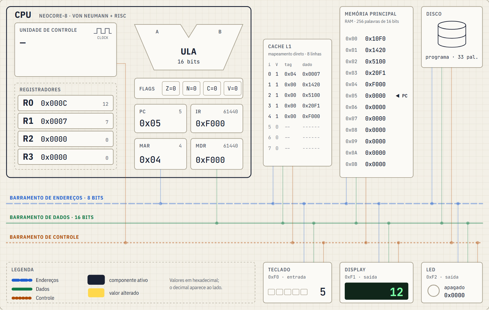

Durante a simulação, o diagrama reage a cada microetapa:

- os componentes ativos "acendem", com as cores invertidas;
- os valores que mudaram ganham uma marca amarela;
- o trecho do barramento em uso é destacado, com o valor transmitido e uma seta indicando o sentido.

Para não depender só de cor (acessibilidade), cada barramento tem também um **padrão de traço** próprio e um rótulo: endereços em azul tracejado, dados em verde contínuo e controle em laranja pontilhado.

## 4. CPU: Unidade de Controle, ULA e registradores

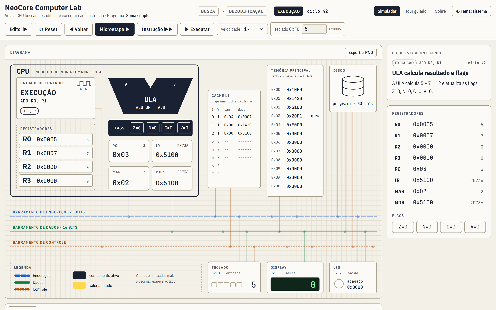

**Unidade de Controle (UC).** A UC é um **sequenciador de microetapas**, uma versão simplificada de uma unidade de controle microprogramada. Seu estado interno indica a fase atual (BUSCA, DECODIFICAÇÃO ou EXECUÇÃO) e qual a próxima microetapa dentro da fase. A busca tem sempre o mesmo plano de 4 microetapas. A decodificação lê o IR e escolhe o plano de execução, que depende da instrução, do endereço acessado (RAM ou E/S) e, nos desvios, das flags. Em cada microetapa, a UC emite os sinais de controle: `MEM_READ`, `MEM_WRITE`, `CLOCK` e `RESET` no barramento do sistema, e `ALU_OP`, `REG_WRITE`, `PC_INC`, `PC_LOAD`, `IR_LOAD` e `HALT` internamente.

**ULA.** Opera sobre palavras de 16 bits e executa cinco operações. A saída é guardada em um registrador interno entre o cálculo e a escrita no registrador de destino.

| Operação | Resultado | Flags atualizadas |
|---|---|---|
| `ADD` | rd + rs | Z, N, C (vai-um), V (overflow com sinal) |
| `SUB` | rd − rs | Z, N, C (empresta-um: rd < rs sem sinal), V |
| `AND`, `OR` | rd & rs, rd \| rs | Z, N (C e V são preservados) |
| `NOT` | ~rd | Z, N (C e V são preservados) |

Na subtração, adotou-se a convenção de **C = empresta-um** (como no x86), mais intuitiva para o aluno ("faltou para subtrair"). `MOV` e `LDI` não passam pela ULA e não alteram flags.

**Registradores.**

| Registrador | Largura | Função |
|---|---|---|
| R0–R3 | 16 bits | uso geral; operandos e resultados da ULA |
| PC | 8 bits | endereço da próxima instrução |
| IR | 16 bits | instrução em decodificação/execução |
| MAR | 8 bits | endereço colocado no barramento de endereços |
| MDR | 16 bits | palavra que chega ou sai pelo barramento de dados |
| FLAGS | 4 bits | Z (zero), N (negativo), C (carry/borrow), V (overflow) |

No painel de registradores, cada valor aparece em hexadecimal e decimal (com sinal, nos registradores de dados), e o binário aparece ao passar o mouse ou focar com o teclado.

## 5. Hierarquia de memória e o papel da cache

| Nível | Representação no simulador | Latência simulada |
|---|---|---|
| Registradores | R0–R3 e especiais, dentro da CPU | sem espera |
| Cache L1 | mapeamento direto, 8 linhas de 1 palavra | 1 ciclo |
| Memória principal (RAM) | 256 palavras de 16 bits | +4 ciclos de espera (*wait states*) por acesso |
| Armazenamento (disco) | guarda o programa; o *loader* o copia para a RAM no boot | só no carregamento |

**Organização da cache.** A cache é **unificada** (instruções e dados), coerente com Von Neumann, e usa **mapeamento direto**. O endereço de 8 bits é dividido em **tag (5 bits) | índice (3 bits)**: o índice escolhe uma das 8 linhas e a tag identifica qual dos 32 endereços possíveis aquela linha guarda. Cada linha tem um bit de validade. Por exemplo, o endereço `0x20` = `00100 000` tem tag `0x04` e índice 0.

**Leitura.** Na microetapa "MEM_READ: consulta à cache", um **HIT** (linha válida com a mesma tag) entrega a palavra em 1 ciclo. Um **MISS** busca a palavra na RAM, com 4 ciclos de espera, e guarda uma cópia na linha. A Figura 4 mostra o primeiro MISS do programa: a cache e a RAM acesas, o endereço `0x00` no barramento de endereços e `MEM_READ` no de controle.

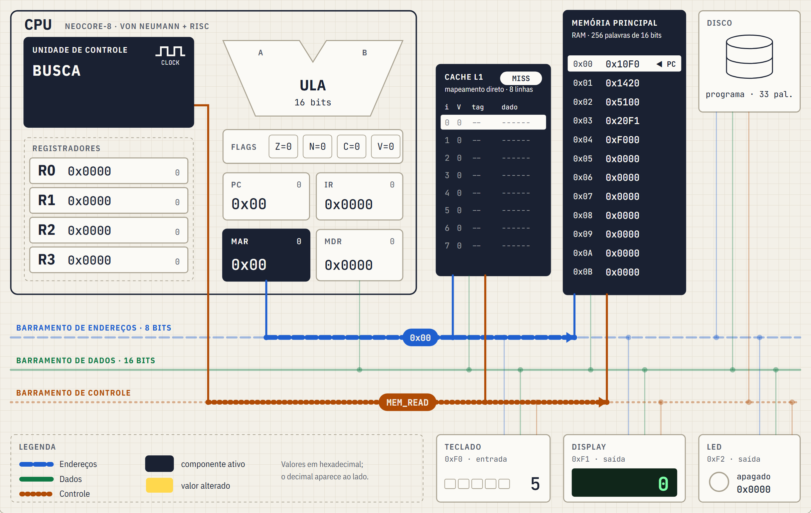

**Escrita.** A política é **write-through** com **no-write-allocate**. A RAM é sempre escrita, o que mantém cache e RAM coerentes; a linha da cache só é atualizada se já contiver o endereço. A região de E/S não é cacheável: esses acessos fazem *bypass*.

**O ganho da cache no exemplo 2.** O programa *Contador com laço* conta de 5 até 0 e mostra cada valor no display. Na primeira volta, as instruções do laço e a constante lida a cada volta dão MISS. A partir da segunda volta, passam a ser HIT. Ao final, **23 de 34 leituras são HIT (67,6%)**, e a execução leva **258 ciclos**, contra **350 ciclos** sem a cache: 92 ciclos economizados, 26% a menos (Figuras 5 e 6). A constante do laço foi colocada em `0x20` (índice 0) de propósito: em `0x0A` (índice 2), ela disputaria a linha com a instrução `LOAD` do laço, e as duas dariam MISS em toda volta. Esse é um exemplo de **falta por conflito**, característica do mapeamento direto.

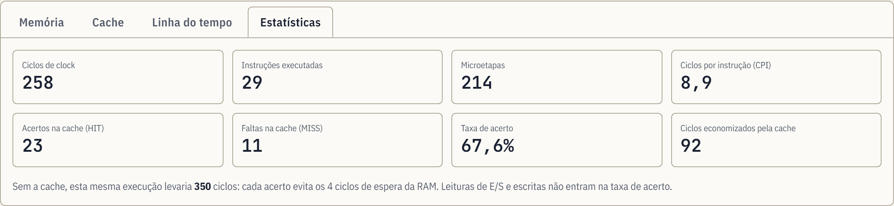

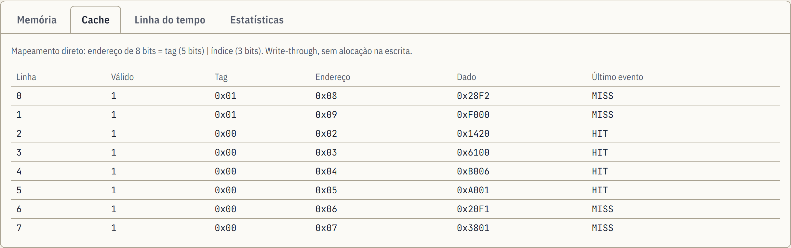

## 6. Barramentos de dados, endereços e controle

| Barramento | Largura | O que transporta | Sentido |
|---|---|---|---|
| Endereços | 8 bits | o endereço que o MAR coloca para a memória ou a E/S | CPU → memória/E/S |
| Dados | 16 bits | a palavra lida ou escrita (via MDR) | bidirecional |
| Controle | sinais | `MEM_READ`, `MEM_WRITE`, `CLOCK`, `RESET` | CPU → memória/E/S |

No diagrama, cada microetapa acende apenas o **trecho** do barramento efetivamente usado. Em um HIT, o trecho vai da CPU até a cache; em um MISS, vai até a RAM, passando pela cache, que guarda a cópia. O sentido do dado segue o sinal de controle: em `MEM_READ`, o dado vai do componente para a CPU; em `MEM_WRITE`, da CPU para o componente. Os sinais internos da CPU (`ALU_OP`, `REG_WRITE`, `PC_INC`, `IR_LOAD`, `PC_LOAD`, `HALT`) **não** trafegam pelo barramento do sistema; o simulador os mostra como etiquetas dentro da Unidade de Controle, para que o aluno não confunda controle interno com controle do sistema.

### 6.1 E/S mapeada em memória

| Endereço | Dispositivo | Uso |
|---|---|---|
| `0xF0` | Teclado | entrada: `LOAD` lê o valor digitado pelo usuário |
| `0xF1` | Display | saída: `STORE` mostra o valor |
| `0xF2` | LED | saída: `STORE` acende conforme os bits do valor |

Todo acesso a `0xF0`–`0xFF` é desviado para os dispositivos: a cache é ignorada e a RAM não responde. O acesso à E/S tem uma **microetapa extra**, na qual o dispositivo responde no barramento. Na leitura do teclado (Figura 7), as microetapas de execução de `LOAD R0, [0xF0]` são:

| # | Microetapa | Sinais | Componentes ativos | Barramentos |
|---|---|---|---|---|
| 1 | MAR ← addr | CLOCK | UC, IR, MAR | end. `0xF0` |
| 2 | MEM_READ: endereço de E/S | CLOCK, MEM_READ | UC, MAR, Teclado | end. `0xF0` (bypass da cache) |
| 3 | Teclado responde | CLOCK, MEM_READ | Teclado | end. `0xF0`, dados `5` |
| 4 | MDR ← E/S[MAR] | CLOCK, MEM_READ | Teclado, MDR | end. `0xF0`, dados `5` |
| 5 | R0 ← MDR | CLOCK, REG_WRITE | UC, MDR, R0 | — |

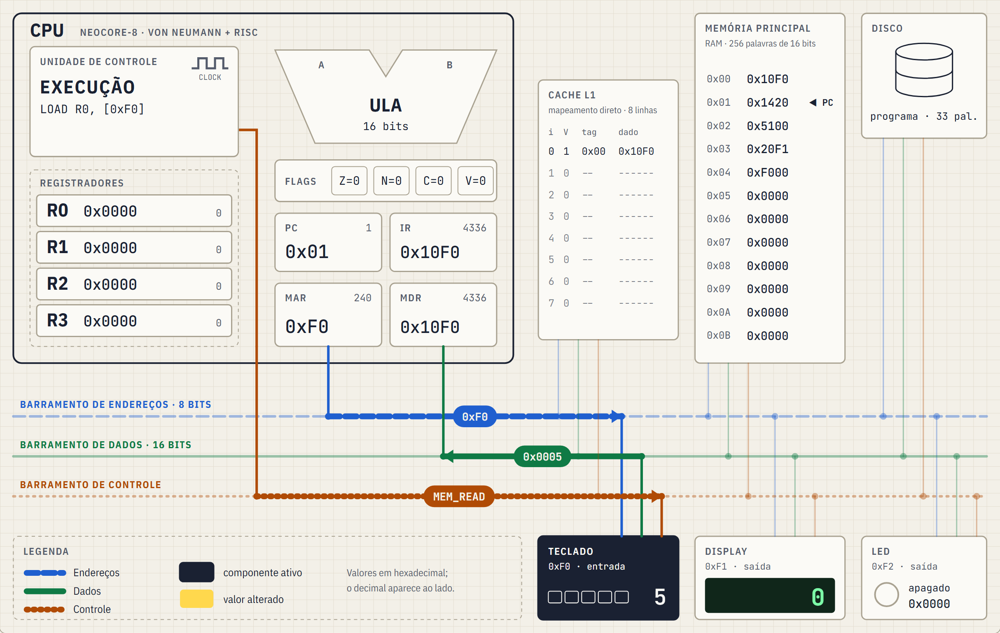

Na escrita, `STORE R0, [0xF1]` prepara o endereço e o dado (`MAR ← addr; MDR ← R0`), ativa `MEM_WRITE` com o valor 12 no barramento de dados e, na microetapa extra, o display captura o valor (Figura 8). O teclado é só de entrada (escritas nele são ignoradas), e endereços da região sem dispositivo leem 0.

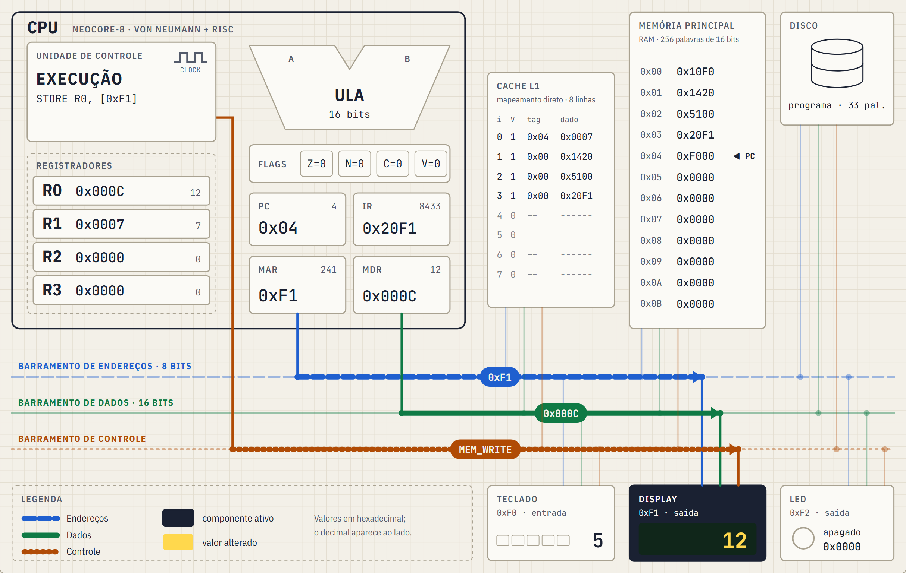

## 7. Fluxo de dados entre os componentes

O programa de demonstração (exemplo 1, *Soma simples*) lê um número do teclado, soma com uma constante da memória e mostra o resultado no display. O montador do simulador gera o seguinte código de máquina (Figura 9):

| Endereço | Assembly | Código | Binário (opcode rd rs imm/addr) |
|---|---|---|---|
| `0x00` | `LOAD R0, [0xF0]` | `0x10F0` | `0001 00 00 11110000` |
| `0x01` | `LOAD R1, [0x20]` | `0x1420` | `0001 01 00 00100000` |
| `0x02` | `ADD R0, R1` | `0x5100` | `0101 00 01 00000000` |
| `0x03` | `STORE R0, [0xF1]` | `0x20F1` | `0010 00 00 11110001` |
| `0x04` | `HLT` | `0xF000` | `1111 00 00 00000000` |
| `0x20` | `.word 7` | `0x0007` | dado |

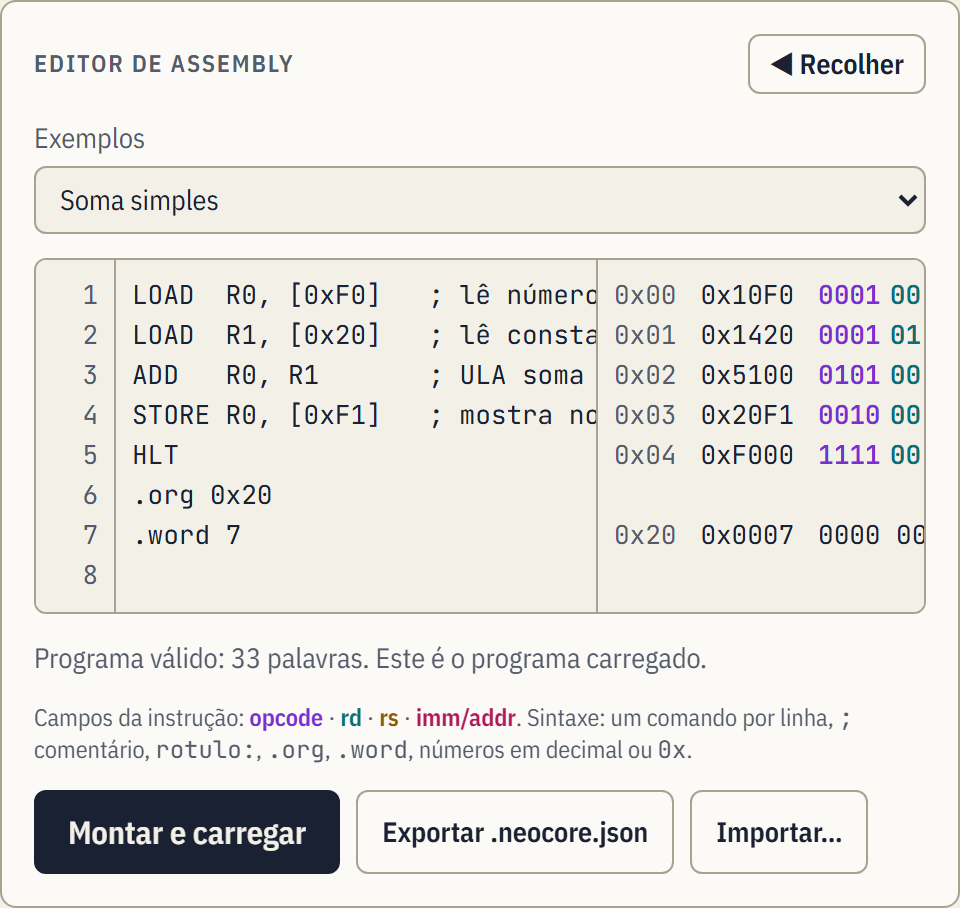

Com a entrada 5, a execução completa tem 42 microetapas (o boot e mais 41) e leva **65 ciclos**. O caminho dos dados em cada instrução é:

| Instrução | Microetapas | Ciclos | Caminho dos dados |
|---|---|---|---|
| `LOAD R0, [0xF0]` | 10 | 14 | Teclado → barramento de dados → MDR → R0 |
| `LOAD R1, [0x20]` | 9 | 17 | RAM (MISS) → barramento de dados → MDR → R1; cópia na cache |
| `ADD R0, R1` | 8 | 12 | R0, R1 → ULA → R0 (e FLAGS) |
| `STORE R0, [0xF1]` | 8 | 12 | R0 → MDR → barramento de dados → Display |
| `HLT` | 6 | 10 | — (a UC ativa HALT) |

Em todas as instruções, a busca traz a palavra da memória pelo mesmo caminho: PC → MAR → barramento de endereços → cache/RAM → barramento de dados → MDR → IR. Ao final, R0 = 12 e o display mostra 12. Esse fluxo é verificado automaticamente por um teste ponta a ponta no navegador (Apêndice A).

## 8. Ciclo de busca, decodificação e execução

Toda instrução passa por três fases, mostradas no indicador **BUSCA → DECODIFICAÇÃO → EXECUÇÃO** no topo do simulador.

**Busca (4 microetapas, idênticas para todas as instruções).**

1. `MAR ← PC`: a UC coloca o PC no barramento de endereços.
2. `MEM_READ: consulta à cache`: HIT (1 ciclo) ou MISS (1 + 4 ciclos de espera da RAM).
3. `MDR ← M[MAR]`: a palavra trafega pelo barramento de dados até o MDR.
4. `IR ← MDR; PC ← PC + 1`: sinais `IR_LOAD` e `PC_INC`.

**Decodificação (1 microetapa).** A UC separa os campos do IR — opcode, rd, rs e imm/addr — e identifica a instrução e a operação (Figura 10). Toda instrução tem 16 bits:

```
 15    12 11  10 9    8 7              0
[ opcode ][  rd  ][  rs  ][ imm / addr ]
  4 bits   2 bits  2 bits     8 bits
```

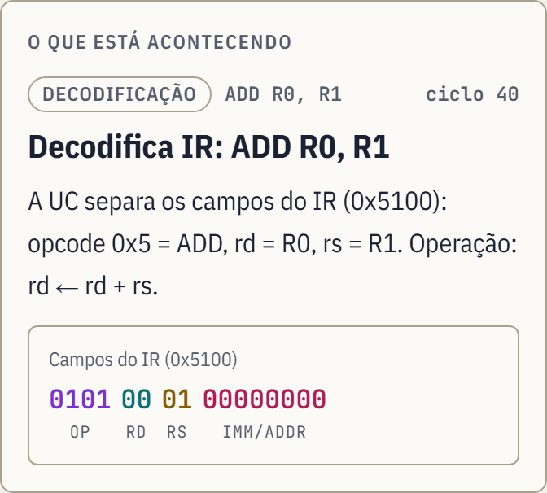

**Execução (varia por instrução).**

| Instrução | Microetapas de execução |
|---|---|
| `NOP`, `LDI`, `MOV`, `JMP`, `HLT` | 1 |
| `ADD`, `SUB`, `AND`, `OR`, `NOT` | 3: entradas da ULA → cálculo e flags → escrita em rd |
| `LOAD` | 4 (RAM) ou 5 (E/S) |
| `STORE` | 2 (RAM) ou 3 (E/S) |
| `JZ`, `JN` | 1 (desvio não tomado) ou 2 (testa a flag e carrega o PC) |

Os opcodes `0xD` e `0xE` são reservados: se aparecerem, a decodificação gera uma **exceção didática** ("instrução inválida") e a máquina para, explicando o motivo, sem travar o simulador. O mesmo acontece se o PC chegar à região de E/S, onde não há instruções.

**Conjunto de instruções.**

| Opcode | Sintaxe | Operação | Flags |
|---|---|---|---|
| `0x0` | `NOP` | nada | — |
| `0x1` | `LOAD rd, [addr]` | rd ← M[addr] | — |
| `0x2` | `STORE rd, [addr]` | M[addr] ← rd | — |
| `0x3` | `LDI rd, imm` | rd ← imm | — |
| `0x4` | `MOV rd, rs` | rd ← rs | — |
| `0x5` | `ADD rd, rs` | rd ← rd + rs | Z N C V |
| `0x6` | `SUB rd, rs` | rd ← rd − rs | Z N C V |
| `0x7` | `AND rd, rs` | rd ← rd & rs | Z N |
| `0x8` | `OR rd, rs` | rd ← rd \| rs | Z N |
| `0x9` | `NOT rd` | rd ← ~rd | Z N |
| `0xA` | `JMP addr` | PC ← addr | — |
| `0xB` | `JZ addr` | se Z = 1, PC ← addr | — |
| `0xC` | `JN addr` | se N = 1, PC ← addr | — |
| `0xF` | `HLT` | para a execução | — |

### 8.1 Execução passo a passo de `ADD R0, R1`

A tabela abaixo é a execução real de `ADD R0, R1` no exemplo 1 (R0 = 5, R1 = 7), gerada pelo motor do simulador. A mesma tabela aparece na página *Sobre* do app, e um teste automatizado garante que este relatório e o motor não divergem.

| # | Fase | Microetapa | Sinais de controle | Componentes ativos | Ciclo |
|---|---|---|---|---|---|
| 1 | Busca | MAR ← PC | CLOCK | UC, PC, MAR | 32 |
| 2 | Busca | MEM_READ: consulta à cache | CLOCK, MEM_READ | UC, MAR, Cache, RAM | 37 |
| 3 | Busca | MDR ← M[MAR] | CLOCK, MEM_READ | RAM, Cache, MDR | 38 |
| 4 | Busca | IR ← MDR; PC ← PC + 1 | CLOCK, IR_LOAD, PC_INC | UC, MDR, IR, PC | 39 |
| 5 | Decodificação | Decodifica IR: ADD R0, R1 | CLOCK | UC, IR | 40 |
| 6 | Execução | ULA ← R0, R1 | CLOCK, ALU_OP | UC, R0, R1, ULA | 41 |
| 7 | Execução | ULA calcula resultado e flags | CLOCK, ALU_OP | ULA, FLAGS | 42 |
| 8 | Execução | R0 ← resultado | CLOCK, REG_WRITE | ULA, R0 | 43 |

O que acontece em cada microetapa, nas palavras do próprio simulador:

1. A UC copia o PC (`0x02`) para o MAR, que coloca o endereço da próxima instrução no barramento de endereços.
2. A UC ativa `MEM_READ` e consulta a cache: o endereço `0x02` tem tag `0x00` e índice 2. A linha 2 está vazia (bit de validade = 0): MISS. O dado precisa vir da RAM, e a CPU aguarda 4 ciclos de espera — por isso o ciclo salta de 32 para 37.
3. A RAM coloca a palavra `0x5100` no barramento de dados. A cache guarda uma cópia na linha 2 (tag `0x00`) e o MDR armazena a palavra.
4. A instrução vai do MDR para o IR (`IR_LOAD`) e o PC avança para `0x03` (`PC_INC`).
5. A UC separa os campos do IR (`0x5100`): opcode `0x5` = ADD, rd = R0, rs = R1. Operação: rd ← rd + rs.
6. A UC envia R0 (5) e R1 (7) para as entradas da ULA e seleciona a operação (`ALU_OP` = ADD).
7. A ULA calcula 5 + 7 = 12 e atualiza as flags Z = 0, N = 0, C = 0, V = 0.
8. O resultado (12) sai da ULA e é gravado em R0 (`REG_WRITE`).

A instrução inteira leva 12 ciclos: 8 da busca (com o MISS) e 4 da decodificação e execução. Se a mesma instrução estivesse em um laço, a busca seguinte seria um HIT e levaria 4 ciclos.

## 9. Conclusão e trabalhos futuros

O NeoCore Computer Lab cumpre o objetivo da prova de conceito: mostra, de forma coordenada e verificável, como a UC, a ULA, os registradores, a cache, a memória, os barramentos e a E/S colaboram em cada instrução. O valor pedagógico está em três escolhas:

- **Nada é ilustrativo.** Tudo o que a interface mostra (componentes acesos, valores nos barramentos, explicações) vem do motor que de fato executa o programa. O aluno vê o que acontece, não um desenho do que deveria acontecer.
- **Controle do ritmo.** Avançar microetapa por microetapa, voltar, executar continuamente e mudar a entrada permitem testar hipóteses ("e se o valor for negativo?") e ver a consequência imediatamente.
- **Programas próprios.** O editor de assembly, com o código de máquina de cada linha e erros explicados em português, liga a programação de baixo nível ao que acontece no hardware.

O **Modo Roteiro** (Figura 11) percorre o exemplo 1 em sete cenas, uma para cada tópico desta apresentação, e é usado para gravar o vídeo pitch (Apêndice B).

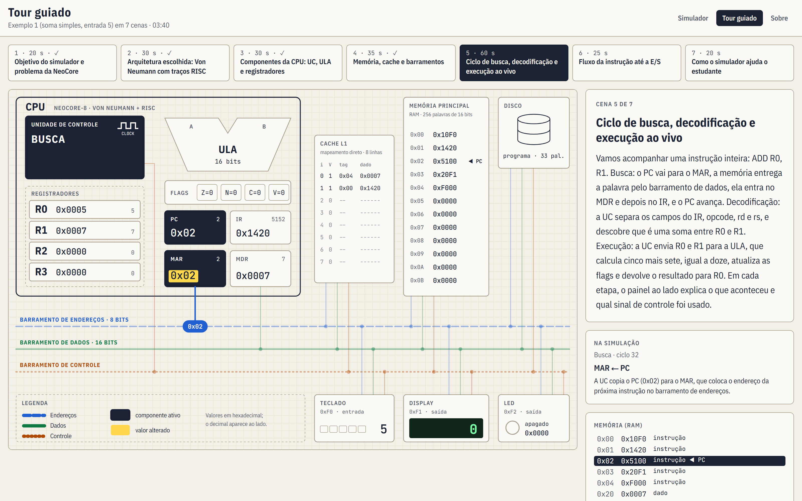

**Validação.** O motor tem 100% de cobertura de testes automatizados. Os testes verificam:

- a codificação e decodificação das 65.536 palavras possíveis;
- as flags da ULA;
- as microetapas e o estado final de cada instrução;
- o comportamento da cache;
- a execução dos três exemplos até o `HLT`.

Também é testado que o diagrama acende exatamente os componentes e barramentos de cada microetapa, e um teste ponta a ponta no navegador confirma o fluxo do exemplo 1 (entrada 5 → display 12).

**Simplificações declaradas.** Para manter cada etapa visível:

- a RAM tem latência fixa;
- os dispositivos de E/S respondem na hora, sem protocolo de *handshake*;
- a cache tem um único nível, com uma palavra por linha (sem localidade espacial);
- o boot é mostrado em uma única etapa;
- a execução é estritamente sequencial.

**Trabalhos futuros.**

- **Pipeline** de 3 ou 5 estágios, com a visualização de *hazards* e *stalls*.
- **Interrupções** e **DMA**, mostrando como a E/S pode operar sem a CPU acompanhar cada palavra.
- **Memória virtual** (tradução de endereços e TLB).
- **Cache associativa e com blocos de várias palavras**, para comparar políticas e localidade espacial.
- **Multiprocessamento**, com coerência de cache entre núcleos.

## Referências

- TANENBAUM, A. S.; AUSTIN, T. *Organização estruturada de computadores*. 6. ed. São Paulo: Pearson Prentice Hall, 2013.
- STALLINGS, W. *Arquitetura e organização de computadores*. 10. ed. São Paulo: Pearson, 2017.
- UNIFECAF. Materiais da disciplina *Computer Architecture and Organization*.

## Apêndice A — Arquivos da simulação

- **Aplicação publicada:** ⟨preencher na Fase 8: link da Vercel⟩
- **Repositório:** ⟨preencher: link do repositório⟩ — o README descreve como rodar, testar e usar o simulador.
- **Páginas:** `/` (simulador), `/tour` (tour guiado) e `/sobre` (arquitetura, ISA e glossário).
- **Programas de exemplo:** *Soma simples*, *Contador com laço* e *Lógica bit a bit*, disponíveis no editor.
- **Arquivo de simulação:** o editor exporta e importa programas no formato `.neocore.json`. O exemplo 1 fica assim:

```
{
  "format": "neocore-lab/programa",
  "version": 1,
  "name": "Soma simples",
  "source": "LOAD  R0, [0xF0]   ; lê número do teclado (E/S)\nLOAD  R1, [0x20]   ; lê constante da memória\nADD   R0, R1       ; ULA soma\nSTORE R0, [0xF1]   ; mostra no display (E/S)\nHLT\n.org 0x20\n.word 7\n",
  "keyboard": 5
}
```

- **Como executar localmente:** `npm install` e `npm run dev`. Os testes rodam com `npm test` (motor e interface) e `npm run test:e2e` (fluxo no navegador).

## Apêndice B — Vídeo pitch

- **Link (YouTube, não listado):** ⟨preencher: link do vídeo⟩
- **Duração:** até 4 minutos, gravado com o Modo Roteiro (`/tour`), que dura 3min40s.
- **Roteiro:** `docs/roteiro-video.md`, com as falas sincronizadas ao tour.

| Cena | Tempo | Tópico |
|---|---|---|
| 1 | 00:00–00:20 | Objetivo do simulador e problema da NeoCore |
| 2 | 00:20–00:50 | Arquitetura escolhida: Von Neumann com traços RISC |
| 3 | 00:50–01:20 | Componentes da CPU: UC, ULA e registradores |
| 4 | 01:20–01:55 | Memória, cache e barramentos |
| 5 | 01:55–02:55 | Ciclo de busca, decodificação e execução ao vivo |
| 6 | 02:55–03:20 | Fluxo da instrução até a E/S |
| 7 | 03:20–03:40 | Como o simulador ajuda o estudante |
